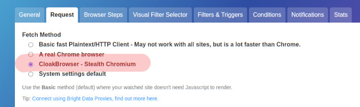

# changedetection.io-cloak-browser

Stealth browser fetcher plugin for [changedetection.io](https://github.com/dgtlmoon/changedetection.io) powered by [CloakBrowser](https://github.com/CloakHQ/CloakBrowser).

- ✅ Bypasses **Cloudflare Turnstile**, reCAPTCHA v3, FingerprintJS, BrowserScan and more
- ✅ 33 source-level C++ patches compiled into Chromium — no JS injection tricks
- ✅ Full **browser steps** support (same Playwright page API)
- ✅ Full **screenshot** and **visual selector** support
- ✅ Drop-in replacement — select "CloakBrowser" per-watch in the UI
- ✅ Proxy support with optional geo-IP auto-detection
- ✅ Human-like behaviour mode to avoid timing-based detection

## Requirements

- changedetection.io >= 0.71.1
- Python 3.10+
- ~200 MB disk space for the CloakBrowser Chromium binary (downloaded automatically on first run)

***NOTE: - The biggest red-flag is still your IP address "quality", always use a high quality 'residential IP address' through a SOCKS style proxy - When you sign up using https://brightdata.grsm.io/n0r16zf7eivq BrightData will match any first deposit up to $150 .***

***Cloak Browser works by downloading a pre-compiled binary chrome-browser from CloakHQ, remember, you are running a black-box piece of software that you do not know what's inside of it.***

## Quick Start

### 1. Install the plugin

**Docker (docker-compose.yml):**

```yaml
services:
  changedetection:
    environment:
      - EXTRA_PACKAGES=changedetection.io-cloak-browser
```

**Local install:**

```bash
pip install changedetection.io-cloak-browser
# Download the Chromium binary
python -m cloakbrowser install
```

### 2. Select CloakBrowser for a watch

In the changedetection.io UI, open any watch → **Edit** → **Request** tab → choose
**"CloakBrowser - Stealth Chromium"** in the **Browser** list. To use it for every watch, make it
the default under **Browsers & Proxies**.

CloakBrowser is a browser like the others there, so you can save your own variations of it
(**Browsers & Proxies** → CloakBrowser → **Add variation**) with a screen size, an emulated phone
or tablet, a language, a timezone, blocked asset types - and CloakBrowser's own **Human-like
behaviour** setting (On / Off / default), then pick a variation per watch or per group.



### 3. (Optional) Environment variables

| Variable | Default | Description |
|---|---|---|
| `CLOAKBROWSER_HUMANIZE` | `true` | Human-like mouse/keyboard/scroll behaviour for browsers that don't set it themselves (each CloakBrowser variation can turn it on or off) |
| `playwright_proxy_server` | *(none)* | Proxy URL, e.g. `http://proxy:8080` |
| `playwright_proxy_username` | *(none)* | Proxy username |
| `playwright_proxy_password` | *(none)* | Proxy password |
| `PLAYWRIGHT_SERVICE_WORKERS` | `allow` | `allow` or `block` service workers |
| `WEBDRIVER_DELAY_BEFORE_CONTENT_READY` | `5` | Seconds to wait after page load |
| `SCREENSHOT_MAX_HEIGHT` | `20000` | Maximum screenshot height in pixels |

## Docker Compose Example

```yaml
version: '3'

services:
  changedetection:
    image: ghcr.io/dgtlmoon/changedetection.io:latest
    container_name: changedetection
    volumes:
      - ./datastore:/datastore
    environment:
      - EXTRA_PACKAGES=changedetection.io-cloak-browser
      - CLOAKBROWSER_HUMANIZE=true
      # Optional proxy
      # - playwright_proxy_server=http://proxy.example.com:8080
      # - playwright_proxy_username=user
      # - playwright_proxy_password=pass
    ports:
      - "5000:5000"
    restart: unless-stopped
```

## How It Works

CloakBrowser is a patched Chromium binary with 33 source-level C++ modifications that
make it indistinguishable from a real user's Chrome browser. Unlike JavaScript-injection
approaches (which detection services can identify), these patches operate at the binary level.

The Python `cloakbrowser` package wraps the Playwright Python library but connects to the
patched binary instead of stock Chromium. This means **the page API is 100% identical to
Playwright** — browser steps, screenshots, visual selectors, and JS execution all work
unchanged.

Because of that, this plugin contains no fetching code of its own: it subclasses
changedetection.io's Playwright fetcher and only replaces how the browser is obtained (it launches
CloakBrowser instead of connecting to a remote Chrome). Everything else is changedetection.io's
own, so the plugin follows core's fixes and features without being updated for them.

# Warnings!

- A pre-built binary chrome will be downloaded from the CloakHQ/Cloak-browser source, this repository has no control
over that file, please consider the implications of running unknown binaries! See https://github.com/CloakHQ/CloakBrowser
- Other leakage such as WebRTC, timezone information, RTT triangulation etc can still reveal the browser type!

### Detection bypass results

| Service | Stock Playwright | CloakBrowser |
|---|---|---|
| reCAPTCHA v3 score | 0.1 (bot) | **0.9** (human) |
| Cloudflare Turnstile | FAIL | **PASS** |
| FingerprintJS | DETECTED | **PASS** |
| BrowserScan | DETECTED | **NORMAL** |
| `navigator.webdriver` | `true` | **`false`** |
| TLS fingerprint | Mismatch | **Identical to Chrome** |

## Browser Steps

CloakBrowser fully supports all changedetection.io browser steps:

- Click element / Click element if exists
- Enter text in field
- Execute JS
- Wait for text / Wait for seconds
- Scroll down
- Check/uncheck checkbox
- Select by label
- Remove elements
- … and all others

This works because CloakBrowser pages are standard Playwright page objects — the browser
steps engine requires no modification.

## Troubleshooting

**Plugin not loading?**
```python
from changedetectionio.pluggy_interface import plugin_manager
print([name for name, _ in plugin_manager.list_name_plugin()])
# Should include: cloak_browser
```

**Browser Steps tab does nothing?**
Needs changedetection.io >= 0.71.1. Older versions only loaded the Browser Steps UI when
`PLAYWRIGHT_DRIVER_URL` was set, even though CloakBrowser doesn't use it.

**Chromium won't start in Docker (missing shared libraries)?**
The stock changedetection.io image doesn't include the system libraries a local Chromium needs
(`libnss3`, `libgbm1`, `libatk-bridge2.0-0`, `libxkbcommon0`, fonts and so on). Build an image on
top of it that installs them, see
[issue #1](https://github.com/dgtlmoon/changedetection.io-cloak-browser/issues/1) for a list that
is reported to work.

**Binary not downloaded?**
```bash
python -m cloakbrowser install
python -m cloakbrowser info
```

**Test that the fetcher registers:**
```python
from changedetectionio.content_fetchers import available_fetchers
print(available_fetchers())
# Should include: ('html_cloakbrowser', 'CloakBrowser - Stealth Chromium')
```

**Check for CloakBrowser updates:**
```bash
python -m cloakbrowser update
```

## License

MIT License — see [LICENSE](LICENSE).

CloakBrowser binary: free-to-use, no redistribution. See
[CloakBrowser BINARY-LICENSE](https://github.com/CloakHQ/CloakBrowser/blob/main/BINARY-LICENSE.md).

By using this software you agree to both the MIT LICENCE and the Cloak Browser licence(s).
